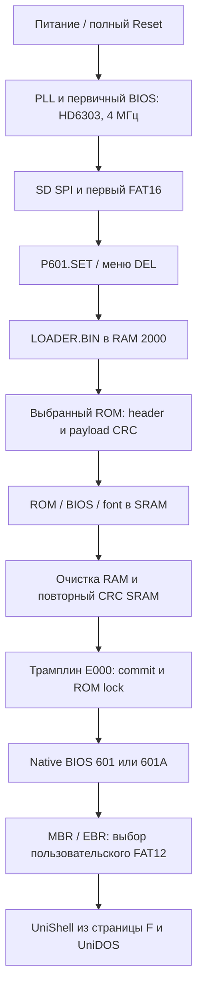

# Загрузка, конфигурация и Reset

Загрузка состоит из трёх программных этапов: первичный BIOS в FPGA EBR,
LOADER.BIN в основной RAM, затем выбранные системный BIOS и ROM-службы.
Файловую систему и CRC обрабатывает CPU. FPGA предоставляет SPI,
физический SRAM-порт и проверяемый ROM lock; аппаратного FAT-загрузчика нет.
Регистры и условия commit подробно описаны в [REGISTERS.md](REGISTERS.md).

## 1. Питание и старт первичного BIOS

Плата использует кварц 12 МГц, PLL создаёт system 24 МГц и SRAM/AY/PAL
fast 96 МГц. Пока PLL не locked, power-reset удерживается; после lock
счётчик выдерживает ещё 255 system-тактов. CPU выполняет bootstrap на
**4 МГц с HD6303 ISA**, независимо от сохранённого рабочего выбора.

Первичный BIOS занимает 8192 байта EBR: F000..FFFF и D000..DFFF.
Reset vector ведёт к cold_start. Код ставит SEI и SP=1FFF,
инициализирует raw PS/2 опрос и MC6845-консоль, затем SD.
Векторные bootstrap IRQ CPU не используются; PAL-тик доступен опросом.
Рабочие ROM-страницы ещё не загружены и ROM lock открыт.

У обеих моделей экран первичного BIOS и LOADING ROM BANKS одинаковый:
601 text 40×24, RAM 0400..07BF, шрифт 8×8, один байт на символ.
Название сообщает выбранную модель, но 601А не переключается здесь
в цветной/80-колоночный режим. Выбранная модель передаётся native-видео
только при commit; её системный BIOS сам устанавливает свои режимы.
Секторный буфер 0800..09FF не пересекается с экраном.

## 2. Инициализация SD и первого FAT16

Начальные SPI control=23h (CS high) и divider=29 дают 400 кГц.
Перед CMD0 BIOS сбрасывает старый PAL pending и ждёт 16 новых тиков:
не менее 300 мс, обычно 300–320 мс. Затем передаёт не менее 80 SCK
при CS high. Это ожидание нужно после включения питания карты.

Порядок:

1. CMD0 до ответа idle=1.
2. CMD8 с проверкой R7/напряжения. Illegal-command допускается для legacy
   SDSC; прочие неправильные ответы не означают успешную инициализацию.
3. CMD55/ACMD41 до ready, с проверкой ответов.
4. CMD58/OCR определяет block addressing SDHC; SDSC использует byte address.
5. Для byte-addressed карты CMD16 задаёт сектор 512 байт.
6. После успеха divider=1: SPI 6 МГц; режим карты хранится для handoff.

CMD0/CMD8/ACMD41 повторяются в ограниченном интервале примерно двух
секунд с deselect и паузой PAL между попытками. Ожидания имеют запасной
CPU-предел при остановленном PAL, опрос байтового READY также ограничен.
При фатальном отказе CS переводится high, BIOS остаётся на экране ошибки.

BIOS читает сектор 0, проверяет MBR и границы **первого первичного раздела**,
затем BPB FAT16. Это раздел для загрузочных файлов, не обязательно
пользовательский загрузочный FAT12. Обрабатываются FAT-цепочки и root
directory; предполагаются 512-байтовые секторы и DOS 8.3 имена в корне.
FAT12/FAT32 вместо FAT16 для этого этапа не поддержаны.

| Файл первого раздела | Назначение |
|---|---|
| LOADER.BIN | Второй загрузчик, выполняемый из RAM 2000 |
| P601.ROM | Комплект ROM/BIOS/font модели 601 |
| P601A.ROM | Комплект модели 601А |
| P601.SET | Сохранённые настройки, 16 байт |
| P601.CFG | Информационный JSON для хоста; BIOS его не использует |

OEM-ID, метка и serial пользовательского FAT12 не задают модель/ISA и
не являются настройками BIOS. [Разметка карты](SD-CARD.md).

## 3. P601.SET и меню конфигурации

После FAT16 mount BIOS ищет P601.SET. Только целиком действительный файл
применяется: размер, magic, версия, значения, резерв и CRC проверяются.
Если файла нет или он невалиден, меню открывается сразу с defaults:
601, HD6303 EXTENSION Y, 1 МГц, BOOT PARTITION AUTO.

С действительной конфигурацией BIOS показывает модель, ISA, начальную
частоту, BOOT PARTITION и отсчёт 10 секунд. DEL открывает редактор;
без ввода начинается загрузка сохранённого выбора. Ранний короткий DEL
сохраняется raw FIFO до опроса меню. Настройки MC6800 тоже действительны
и не заменяются defaults при обычной загрузке.

| Строка | Возможные значения / действие |
|---|---|
| MODEL | 601 / 601A |
| CPU HD6303 EXTENSION | N=MC6800 / Y=HD6303 ISA |
| CPU FREQ | 1 / 2 / 4 / 8 МГц |
| BOOT PARTITION | AUTO / SD0:PART1..SD0:PART36 |
| SAVE AND BOOT | Записать P601.SET, прочитать обратно, проверить, загрузиться |
| BOOT WITHOUT SAVE | Применить на этот запуск, не менять карту |
| EXIT AND BOOT | Отменить правки и загрузить исходный выбор |

Вверх/вниз выбирают строку; влево/вправо, Enter или Space меняют значение;
Enter на действии выполняет его. ESC соответствует EXIT AND BOOT.
Только после выхода из меню конфигурационный байт отправляется в E6A0,
выбор AUTO/раздела — в E6AE; это должно произойти до первого E6A3.
Bootstrap CPU и консоль на этом шаге ещё остаются HD6303/4 МГц/40×24.

### Формат настроек

| Смещение | Размер | Значение |
|---:|---:|---|
| 0 | 8 | ASCII `P601SET` + NUL |
| 8 | 1 | Версия 2; версия 1 принимается как AUTO |
| 9 | 1 | bit0 model A; bit1 HD6303; bits3:2 speed 0/1/2/3=1/2/4/8 МГц; остальные 0 |
| 10 | 1 | 0=AUTO или номер раздела 1..36; в v1 ноль |
| 11 | 3 | Нулевой резерв |
| 14 | 2 | CRC16-CCITT bytes0..13: polynomial 1021h, initial 0, **big endian** |

SAVE выполняется программным SPI CMD24. Существующий файл сохраняет
root entry и FAT-цепочку; меняется сектор данных. При создании нового
файла BIOS находит свободные root slot/кластер, пишет и перечитывает
данные, обновляет копии FAT, публикует root entry последним. Busy SD
ожидается до FF, промежуточные неполные значения не считаются успехом.
Ошибка даёт `SAVE FAILED - CHECK SD` и оставляет редактор с правками.
Журналирования при потере питания во время создания файла нет.

## 4. Загрузка LOADER.BIN

Первичный BIOS открывает LOADER.BIN через свой FAT16 API. Его длина
должна быть ненулевой и меньше 4096 байт. Файл копируется по 2000,
после чего выполняется JMP 2000. Loader не заменяет BIOS API: продолжает
читать первый FAT16 через процедуры F003/F006 резидентного BIOS.

| Вход bootstrap BIOS | Назначение |
|---|---|
| F000 | Cold start |
| F003 | Открыть root file: X указывает на 11-байтовое DOS 8.3 имя без точки |
| F006 | Получить следующий байт открытого файла в A |
| F009 | Фатальная ошибка bootstrap |
| F00C | Проверить SRAM, выполнить commit и перейти к выбранному BIOS |
| F00F | Показать STEP из A; A/B/X сохраняются |
| F012 | Показать BLOCK: A текущий, B всего; A/B/X сохраняются |

После открытия размер файла доступен в B_SIZE=$0100..0103 в little endian.
Другие рабочие переменные bootstrap — внутреннее соглашение boot.asm,
не универсальный runtime ABI. После handoff эти входы относятся уже
к выбранному системному ROM, обращаться к ним как к загрузчику нельзя.

## 5. Контейнер P601BOOT v2

Loader читает E6A0.bit0 и открывает P601.ROM или P601A.ROM.
Размер должен быть **72192 байта**: header 512 + payload 71680.
Header читается в RAM 1000..11FF, загрузчик остаётся по 2000.

| Header offset | Размер | Значение |
|---:|---:|---|
| 0 | 8 | ASCII `P601BOOT` |
| 8 | 4 | Version=2, LE32 |
| 12 | 4 | Physical ROM base=00010000h, LE32 |
| 16 | 4 | Payload bytes=00011800h, LE32 |
| 20 | 4 | CRC32 всех 71680 payload bytes, LE32 |
| 24 | 1 | 0, резерв; не BOOT PARTITION в v2 |
| 25 | 1 | Model: 0=601, 1=601А |
| 26 | 482 | Нулевой резерв текущего контейнера |
| 508 | 4 | CRC32 header bytes0..507, LE32 |

CRC32 в обоих случаях отражённый EDB88320h, initial FFFFFFFFh,
final XOR FFFFFFFFh. Регистр CRC сначала сбрасывается; для header
в него подаются первые 508 байт. Последние четыре сравниваются с итогом.
Номер модели также сравнивается с E6A0 до загрузки payload.

Первые 64 header bytes передаются E6A3. FPGA запоминает их последовательность
и проверяет фиксированные поля, model и expected payload CRC. Полный
header CRC проверяет **программный** loader; FPGA не читает файл сама.
В v2 нет таблицы дискет, CHS-конфигурации или ROM/RAM-диска.
Выбор пользовательского загрузочного раздела уже отдельно сохранён E6AE.

| Payload offset / physical SRAM | Размер | Содержимое |
|---|---:|---|
| 00000 / 10000..1FFFF | 65536 | Страницы ROM 8..F, по 8192 |
| 10000 / 20000..20FFF | 4096 | Системный BIOS выбранной модели |
| 11000 / 21000..217FF | 2048 | Шрифт |

Полный physical payload непрерывен: 10000..217FF. Loader пишет его
через E6A4..E6A7, ждёт завершения каждого запроса и отдельно подаёт
тот же байт в E6A9. По окончании сверяет CRC с header offset20.
Font writes в physical 21000..217FF также обновляют видеошрифт EBR.
[Состав ROM и сборка](FIRMWARE.md).

## 6. Очистка RAM, проверка SRAM и commit

Loader очищает physical базовую RAM **3000..FFFF** через bootstrap-порт.
ROM, расширенные RAM-банки и графические страницы этим не очищаются.
Нижняя RAM пока содержит работающий loader, stack/header/переменные,
поэтому её нельзя стирать этим циклом. Затем выполняется JMP F00C.

Резидентный handoff:

1. STEP 0C: CRC-регистр сбрасывается, физическое чтение E6AB последовательно
   перечитывает **все 71680 байт** SRAM 10000..217FF. Каждый законченный
   байт подаётся E6A9. Итог сравнивается с payload CRC в RAM header.
2. STEP 0B: в обычную RAM E000 копируется 17-байтовый MC6800-совместимый
   трамплин из boot.asm. Он остаётся видимым и до, и после lock.
3. Режим SD передаётся E6A2 (write bit6), чтобы runtime-драйвер различал
   SDHC LBA и SDSC byte address без новой холодной инициализации.
4. Очищается CPU RAM 0000..2FFF, включая старый экран, loader и stack.
   После этого код не делает JSR/RTS, требующих стёртого bootstrap-стека.
5. JMP E000; трамплин пишет A5 в E6A0 и проверяет LOCKED.
6. После lock читает **выбранный** reset vector FFFE/FFFF и делает JMP по нему.
   Это запуск native BIOS программным переходом, не дополнительный импульс
   аппаратного reset. Native BIOS сам устанавливает рабочий стек/порты.

В момент lock D000/F000 bootstrap overlay исчезает, включается сохранённая
ISA/модель, выбранная частота применяется на границе полного CPU bus cycle.
Память ROM/BIOS/font остаётся защищённой при всех warm reset.
Commit требует оконченного SPI и высокого CS; SD-драйвер оставляет карту
в этом состоянии. Если аппаратная проверка отвергла commit, трамплин
останавливается до запуска недействительного ROM.

Проверки различаются: CRC header обнаруживает повреждение описания;
CRC полученного payload — ошибку данных файла; повторный CRC SRAM —
неверную запись/чтение физической памяти; commit проверяет согласованность
параметров и последнего CRC. Ни одна из них не является криптографической
подписью или проверкой доверенного происхождения ROM.

## 7. Native BIOS, разделы и UniDOS

Выбранный BIOS 601/601А устанавливает native-видеорежим, проверяет ROM
страницы/контрольные суммы и инициализирует службы. Векторы страниц
и прерываний после этого принадлежат системному BIOS, а не bootstrap.
Программный драйвер клавиатуры и менеджер RAM используют собственные
небольшие resident-области; контекст GAMEBIOS выделяется только приложением.

Вместо чтения загрузочной дискеты BIOS вызывает **INT E1 A=7**.
SDPARTS сканирует MBR/extended EBR через INT E2 по физическому LBA.
Выбор пользовательского системного тома:

1. Явный SD0:PARTn из E6AE имеет приоритет. Ошибка этого выбора
   останавливает boot, а не подменяет том другим.
2. AUTO ищет первый активный пригодный FAT12.
3. Если его нет, пробует разделы 2, затем 3 — резерв прежних A/B.

Выбранный FAT12 получает A:. Остальные пригодные FAT12 подключаются
на свободные буквы в порядке таблицы; чужие файловые системы не монтируются.
Первичные номера 1..4, логические 5..36. FAT16 первого раздела обслуживает
bootstrap; UniDOS-драйвер его как пользовательский диск не подключает.
OEM, serial и label могут быть произвольными; важны действительный BPB
и границы. Код boot-сектора FAT12 **не исполняется**.

INT E3 страницы F распаковывает UniShell в обычную RAM начиная с 1000;
страница A передаёт ей управление. Оболочка UniDOS находится в ROM,
а содержимое A/B/C — файлы SD-разделов. Нет эмуляции i8272, отдельного
ROM-диска и RAM-диска. [Дисковый ABI](FPGA-BIOS.md), [утилиты](STORAGE.md).

## STEP и ошибки

| STEP | Действие |
|---|---|
| 01 | INITIALIZING SD |
| 02 | READING MBR / FAT16 |
| 03 | LOADING LOADER.BIN |
| 04 | OPENING SELECTED ROM |
| 05 | CHECKING ROM HEADER |
| 06 | LOADING ROM BANKS |
| 07 | LOADING BIOS / FONT |
| 08 | CHECKING ROM CRC32 |
| 09 | INITIALIZING RAM |
| 0C | VERIFYING SRAM CRC32 |
| 0B | STARTING SELECTED BIOS |
| EE в E6A1 | Фатальный отказ bootstrap |

Номера показываются в hex; 0C выполняется **до** 0B. Старый текст для
0A про ROM disk остался неиспользуемой строкой в исходнике, этапа
инициализации ROM-диска в текущем пути нет. BLOCK отображает прогресс,
не является отдельным этапом. Ошибки, обнаруженные программным BIOS/loader,
идут через F009: текущий STEP сохраняется для сообщения, debug получает EE,
CS отпускается, CPU остаётся в цикле. Отказ аппаратного commit в E000
обрабатывается иначе: трамплин остаётся в своём цикле, debug может остаться
0B, а экран уже очищен. Причину смотреть по E6A0.ERROR/LOCKED; EE и новое
сообщение в этом пути не выдаются.
Отсутствующий loader/ROM, неверные размеры, FAT-цепочки, model/header/CRC
не приводят к исполнению частично загруженного ROM.

## Reset и смена скорости

| Действие | Результат |
|---|---|
| Короткое нажатие/отпускание | В runtime 1→2→4→8→1 МГц; модель/ISA/SD не меняются |
| Удержание около 2 с | Warm reset CPU/периферии; ROM lock и SRAM сохраняются; возврат к начальной скорости из BIOS |
| Удержание 10 с | После завершения принятых SRAM/SPI операций снимается lock; после отпускания заново bootstrap/SD/settings/ROM |
| Включение питания или потеря PLL lock | Cold reset, bootstrap начинается заново |

Обе границы кнопки фильтруются по 20 мс. Новая скорость применяется после
falling edge завершённого CPU цикла и освобождения SRAM, без обрыва
текущего обращения. Видео/PAL, SD SPI и master AY не зависят от скорости CPU.
Двухразрядный индикатор показывает runtime 01/02/04/08, bootstrap всегда 04.
Одна удержанная кнопка не вызывает повторные reload и не выдаёт короткое
нажатие при отпускании. Reset не записывает разделы SD сам по себе.

Warm reset сбрасывает периферию, E6F0/E6F1, raw capture и музыкальный
таймер, затем native BIOS запускается из сохранённого ROM. RAM physically
сохраняется, но её программное содержимое/выделения могут переинициализировать
BIOS и UniDOS; это не способ продолжить прерванную игру.
Для изменения модели/ISA/BOOT PARTITION вернуться в полный bootstrap и DEL.

## Исходники и проверки

Реализация: `firmware/boot.asm`, `firmware/setup.asm`, `firmware/loader.asm`,
`rtl/classic_boot_ports.v`, `rtl/boot_spi_registers.v`, `rtl/classic_system.v`,
`firmware/partitions/PARTS.ASM`, `firmware/bios/UNISHELL.ASM`.
Проверки соответствующего слоя: test-rtl (boot header/ports), test-setup,
test-sd-init, test-boot-console, test-handoff и test-boot-partitions.
Точные команды и оборудование сборки — [BUILD.md](BUILD.md).
